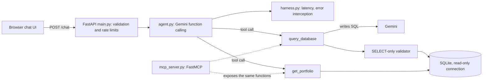

# LifeOps OS: AI Portfolio Copilot

A small, deployed AI agent that answers questions about my background and a demo dataset. Visitors chat with it; Gemini decides which tool to call, and the tool reads from a SQLite database.

**Live demo:** https://lifeops-copilot.onrender.com
(Free hosting: the first request after a quiet period can take up to a minute to wake up.)

## What it does
- Answers questions about my experience, certifications, education and projects (`get_portfolio` tool).
- Answers questions about sample expenses and tasks by having the model write SQL (`query_database` tool). This is demo data, not real finances.
- Politely declines anything outside that scope.

## Architecture



| Piece | File | What it does |
|---|---|---|
| API and static UI | `backend/main.py`, `index.html`, `static/` | Serves the chat page; validates input; per-IP and global rate limits; `/health` shows the Python version and model |
| Agent | `backend/agent.py` | Gemini function calling: the model chooses which tool to call and with what arguments |
| Tools / MCP server | `backend/mcp_server.py` | Two tools, registered with FastMCP so any MCP client can use them. The web app calls the same functions in-process; it is not itself an MCP client |
| Database | `backend/database.py` | SQLite schema, seed data, SELECT-only validation, read-only connection |
| Skills | `backend/skills/*.md` | Markdown instruction files loaded into the system prompt. A simple version of agent skills, not on-demand discovery |
| Harness | `backend/harness.py` | Wraps each run: measures latency, intercepts errors, treats empty output as a failure |
| Rate limiting | `backend/ratelimit.py` | In-memory sliding window: 10 requests/minute per IP, 300/hour overall |

## Safety design
SQL written by an LLM is untrusted input, so two independent layers protect the database:
1. A validator allows one `SELECT` statement only (no comments, no write or schema keywords).
2. The query runs on a read-only SQLite connection, so even a bypassed validator cannot modify data.

Other measures: input length limits, errors are logged server-side and the visitor sees a generic message, model output is HTML-escaped before display, and the system prompt tells the model to ignore instructions embedded in visitor messages. The prompt is a mitigation, not a guarantee; the layers above are the actual protection.

## Testing
- `pytest` unit tests cover the SQL validator (including injection attempts), the read-only connection, the tools, the harness, the agent's tool tracing, and the rate limiter.
- The model is stubbed in CI, so tests are free and deterministic. GitHub Actions runs them on every push.
- `tests/test_agent.py` also contains a live evaluation that checks the real model picks the right tool. It runs only when `GEMINI_API_KEY` is set.

## Run locally
```bash
python -m venv venv
venv\Scripts\activate            # macOS/Linux: source venv/bin/activate
pip install -r requirements-dev.txt
export GEMINI_API_KEY=your-key   # PowerShell: $env:GEMINI_API_KEY="your-key"
uvicorn backend.main:app --reload
pytest -v
```

## Deployment
Render free web service, auto-deployed from `main`. Python is pinned with `.python-version` (3.11.9). Build: `pip install -r requirements.txt && python backend/database.py`. Start: `uvicorn backend.main:app --host 0.0.0.0 --port $PORT`.

## Bugs I hit and how I fixed them
- **Keyword routing replaced by function calling.** The first version used `if "task" in message` to pick data. The model now chooses tools itself.
- **Generated SQL missed data.** The model wrote `category = 'groceries'` but the data stored `'Groceries'`, and SQLite text comparison is case-sensitive, so the answer was $0. I found it by reading the generated SQL the API returns, added `COLLATE NOCASE` to the schema, told the model to compare case-insensitively, and added a regression test.
- **Silent file overwrites.** Early in development, whole-file rewrites pasted into a terminal reverted earlier fixes (a working SQL tool and its tests were lost). I moved to editing in a real editor with diffs, and added tests and CI so regressions fail loudly.
- **Stale frontend.** A leftover `index.html` stub referenced the wrong element IDs, so Send did nothing. A diff against the intended version made the cause obvious.
- **Wrong Python runtime.** `runtime.txt` is ignored by Render, so it ran on 3.14. Pinning via `.python-version` is confirmed at `/health`.
- **Model deprecation.** Model names changed during development; the model is now configurable with the `GEMINI_MODEL` environment variable.

## Limitations and next steps
- Rate limits are in memory and per-IP headers can be spoofed; the global hourly cap is the real quota protection.
- Not built on Google's Agent Development Kit; this uses the `google-genai` SDK directly.
- The web app could act as a true MCP client instead of calling tools in-process.
- Skills could be loaded on demand instead of always being in the prompt.