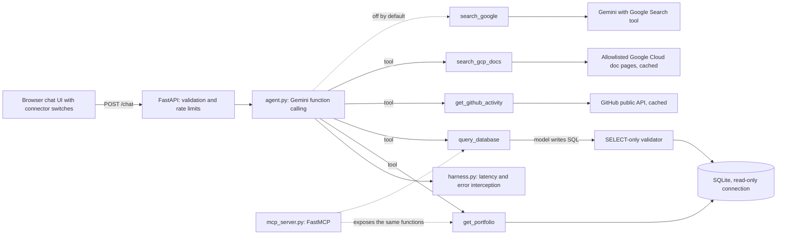

# LifeOps OS: AI Portfolio Copilot

A small, deployed AI agent. Visitors chat with it; Gemini decides which tool to call, and each tool is a switchable "connector" in the UI, similar to data sources in an enterprise AI assistant.

**Live demo:** https://lifeops-copilot.onrender.com
(Free hosting: the first request after a quiet period can take up to a minute.)

## What it does
- Answers questions about my experience, skills, certifications, education and projects.
- Answers questions about a sample expenses and tasks database by having the model write SQL.
- Reports live data from my public GitHub account.
- Answers "what is this Google Cloud product" questions from official documentation, with links.
- Politely declines anything outside that scope, and tells the visitor which connector to switch on if a question needs one that is off.

## Connectors

| Connector | Default | What it retrieves | How |
|---|---|---|---|
| Portfolio profile | on | My background, from SQLite | Tool call, read-only SQL |
| Sample database | on | Demo expenses and tasks | Model-written SQL, validated and read-only |
| GitHub (live) | on | Public repos and latest commits | GitHub REST API, 10-minute cache |
| Google Cloud docs | on | Passages from four official documentation pages | Live fetch from a fixed allowlist, 6-hour cache, BM25-style keyword ranking, citations |
| Google Search grounding | off | Cited web answers | Gemini with the Google Search tool. Implemented, but it needs search-grounding quota that a free API key did not have |

The agent only receives tools for the connectors that are switched on, so an "off" connector cannot be used. This is tool-based retrieval with citations; it does not use embeddings or a vector database.

## Architecture



| Piece | File | What it does |
|---|---|---|
| API and static UI | `backend/main.py`, `index.html`, `static/` | Serves the chat page, validates input, rate limits, `/connectors`, `/health` (shows Python version and model) |
| Agent | `backend/agent.py` | Gemini function calling: the model picks tools; builds the tool list from enabled connectors; returns sources and follow-up prompts |
| Connector registry | `backend/connectors.py` | Names, descriptions and defaults of the switchable connectors |
| Tools / MCP server | `backend/mcp_server.py` | Portfolio and SQL tools, registered with FastMCP so any MCP client can use them. The web app calls the same functions in-process; it is not itself an MCP client |
| Database | `backend/database.py` | SQLite schema, seed data, SELECT-only validation, read-only connection |
| GitHub tool | `backend/github_tools.py` | Public repos and commits for my account only, cached, fails soft |
| Docs retrieval | `backend/docs_tools.py` | Fetches four allowlisted pages, splits them into passages, ranks them, returns passages with links |
| Search grounding | `backend/grounding.py` | Wraps Gemini's Google Search tool as a separate model call, with an hourly cap |
| Skills | `backend/skills/*.md` | Markdown instruction files loaded into the system prompt. A simple version of agent skills, not on-demand discovery |
| Harness | `backend/harness.py` | Wraps each run: latency, error interception, empty output treated as failure |
| Rate limiting | `backend/ratelimit.py` | In-memory sliding window |

## Safety design
SQL written by an LLM is untrusted input, so two independent layers protect the database:
1. A validator allows one `SELECT` statement only (no comments, no write or schema keywords).
2. The query runs on a read-only SQLite connection, so even a bypassed validator cannot modify data.

Other measures:
- Input is limited to 500 characters; errors are logged server-side and visitors see a generic message.
- Rate limits: 10 requests per minute per IP and 300 per hour overall; Google Search grounding has its own hourly cap.
- Docs retrieval uses a fixed allowlist of URLs (visitors never supply one) and rejects redirects outside Google's domains. The GitHub tool only accepts names of my own public repositories.
- Model output is HTML-escaped before display, and only links from `https://` sources are rendered as links.
- The system prompt tells the model to ignore instructions inside user messages and tool results, and to say plainly when a tool is unavailable instead of answering from memory. The prompt is a mitigation, not a guarantee; the code-level layers above are the actual protection.

## Testing
- `pytest` unit tests cover the SQL validator (including injection attempts), the read-only connection, the tools, the harness, rate limiting, connector toggling, GitHub caching and failure handling, docs ranking and caching, and the allowlist.
- External services are stubbed in CI, so tests are free and deterministic. GitHub Actions runs them on every push.
- `tests/test_agent.py` includes a live evaluation that checks the real model picks the right tool. It runs only when `GEMINI_API_KEY` is set.

## Run locally
```bash
python -m venv venv
venv\Scripts\activate            # macOS/Linux: source venv/bin/activate
pip install -r requirements-dev.txt
export GEMINI_API_KEY=your-key   # PowerShell: $env:GEMINI_API_KEY="your-key"
uvicorn backend.main:app --reload
pytest -v
```

| Variable | Purpose |
|---|---|
| `GEMINI_API_KEY` | Required |
| `GEMINI_MODEL` | Chat model (default set in code) |
| `GITHUB_USER` / `GITHUB_TOKEN` | Account to read; token is optional and raises the GitHub rate limit |
| `RATE_LIMIT_PER_MINUTE` / `RATE_LIMIT_GLOBAL_PER_HOUR` | Rate limits |
| `DOCS_MIN_SCORE` | Minimum keyword score for docs passages |
| `GROUNDING_MAX_PER_HOUR` | Cap on Google Search grounding calls |

## Deployment
Render free web service, auto-deployed from `main`. Python is pinned with `.python-version` (3.11.9) and confirmed at `/health`. Build: `pip install -r requirements.txt && python backend/database.py`. Start: `uvicorn backend.main:app --host 0.0.0.0 --port $PORT`.

## How it was built
The first version was written with Gemini through chat prompts (vibe coding). I then reviewed and rebuilt it with a second AI assistant as a reviewer, deciding myself what to apply and checking every change with diffs, tests, CI and live requests. See [docs/ai-review.md](docs/ai-review.md) for the findings and decisions.

## Bugs I hit and how I fixed them
- **Keyword routing replaced by function calling.** The first version used `if "task" in message` to pick data. The model now chooses tools itself.
- **Generated SQL missed data.** The model wrote `category = 'groceries'` but the data stored `'Groceries'`, and SQLite text comparison is case-sensitive, so the answer was $0. I found it by reading the generated SQL in the API response, added `COLLATE NOCASE`, told the model to compare case-insensitively, and added a regression test.
- **Silent file overwrites.** Early on, whole-file rewrites pasted into a terminal reverted earlier fixes (a working SQL tool and its tests were lost). I moved to an editor with diffs, and added tests and CI so regressions fail loudly.
- **Stale frontend.** A leftover `index.html` referenced the wrong element IDs, so Send did nothing. A diff against the intended version made the cause obvious.
- **Wrong Python runtime.** `runtime.txt` is ignored by Render, so it ran on 3.14. Pinning with `.python-version` is confirmed at `/health`.
- **Mocked tests passed while a live integration failed.** Google Search grounding returned 429 and 404 errors on my free key (the 3.x models had no grounding quota; 2.5 models were no longer available to new keys), while unit tests with stubbed calls stayed green. I now check live integrations separately, and the app tells visitors when a tool is unavailable instead of answering from memory.
- **A tool failure was hidden by the model.** When the search call failed, the model answered from memory as if it had searched. A system-prompt rule now requires saying so plainly.
- **Keyword scores do not measure relevance.** A loosely related question scored as high as a clean match, because the score grows with the number of matched common words. I tightened the prompt so partial matches are described as partial, and I treat the score as a debugging aid only.

## Limitations and next steps
- Docs retrieval is keyword-based over four pages; it can miss synonyms and is not a general knowledge base. Content can be up to 6 hours old.
- Google Search grounding is implemented but disabled by default because it needs quota my free key does not have.
- Rate limits are in memory and per-IP headers can be spoofed; the global hourly cap is the real quota protection.
- Not built on Google's Agent Development Kit; this uses the `google-genai` SDK directly.
- The web app could act as a true MCP client instead of calling tools in-process.
- Skills could be loaded on demand instead of always being in the prompt.

## Credits
Documentation excerpts in the Google Cloud docs connector: Google, licensed CC BY 4.0, with links to the source pages.